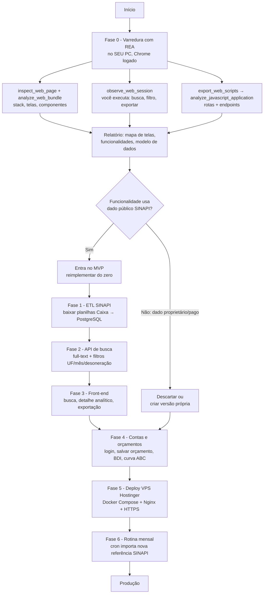
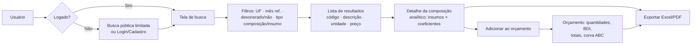
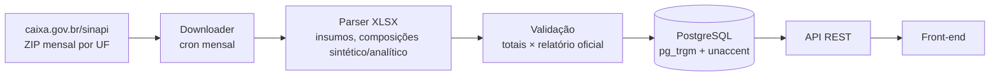
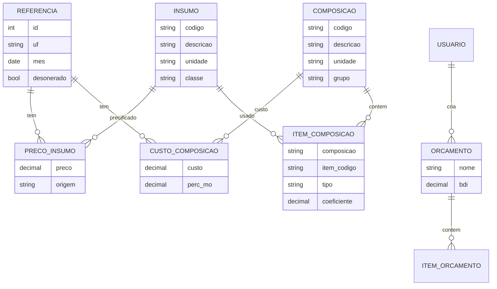

# Plano: recriar um "Buscador SINAPI" próprio (AXIS-BUSCASINAP)

> Status: **rascunho v1** — 31/10/2026
> Referência funcional: https://app.buscadorsinapi.com.br
> Ferramenta de análise: [morluto/rea](https://github.com/morluto/rea) (REA — Reverse Engineer Anything)
> Destino: VPS Hostinger (Ubuntu + Docker)

---

## 1. O que foi verificado

### 1.1 Repositório REA (lido por completo na estrutura e docs relevantes)

O REA **não é um gerador de sites nem um template de app**. É um servidor MCP + CLI
(`npx rea-agents setup` / `rea ...`) que conecta um agente de IA (Claude Code, Codex,
Cursor...) a ferramentas de **engenharia reversa**: binários nativos (Ghidra/IDA/Hopper),
apps Electron/JS, .NET, Android e **sites via Chrome DevTools Protocol (CDP)**.

Ferramentas do REA úteis para um app web:

| Ferramenta REA | O que entrega para este projeto |
|---|---|
| `list_browser_targets` | Lista as abas do seu Chrome aberto com `--remote-debugging-port=9222` |
| `inspect_web_page` | DOM, árvore de acessibilidade, scripts, recursos, metadados de rede/console, nomes de chaves de storage (com `include_script_sources`) |
| `observe_web_session` | Grava navegação/SPA/redirects enquanto **você** clica (busca, filtro, exportação) |
| `observe_web_execution` | Quais funções JS rodaram em cada ação + requisições disparadas |
| `capture_browser_scenario` | Captura de cenário com corpos de resposta da rede |
| `export_web_scripts` → `analyze_javascript_application` | Exporta os bundles JS e gera grafo de módulos, **inventário de rotas** e **endpoints de API** candidatos |
| `analyze_web_bundle` | Detecta framework/vendors (React, Next, Vue, Bubble, FlutterFlow, Supabase, Firebase…), rotas e endpoints sem executar código |
| `inspect_web_network_capture` | Lê um arquivo **HAR** (exportado do DevTools) offline |

Pontos importantes do REA:
- É **passivo e local**: anexa a um navegador **seu**, já logado por você. Ele **não faz login,
  não clica e não contorna autenticação** — isso é por design.
- O `DISCLAIMER.md` exige que você tenha autorização e respeite os termos de uso do serviço
  analisado. Ele **não autoriza** extrair dados protegidos nem contornar controles de acesso.

### 1.2 Varredura do app.buscadorsinapi.com.br — **não foi possível nesta sessão**

- `curl` → bloqueado pelo proxy do ambiente na nuvem (`CONNECT 403`, host fora da lista permitida).
- WebFetch → `ENOTFOUND` (mesma causa: domínio não liberado na política de rede).
- Pesquisa web → nenhum resultado indexado para "Buscador SINAPI"/buscadorsinapi.com.br.

Ou seja: **não cheguei à tela de login**, então a dificuldade não foi o login em si, e sim o
acesso de rede. Não tenho (e não devo pedir) sua senha. A varredura real precisa ser feita
**no seu computador**, com o REA, no seu Chrome logado — roteiro na seção 4.

### 1.3 Confirmado pela captura de tela da tela de login (enviada pelo usuário)

- Cabeçalho azul (`~#2F6699`) com ícone de lupa, título **"Buscador SINAPI"**, selos **EXPERT** (contorno) e **BETA** (amarelo), link externo **"Site"**.
- Card "ACESSO / Entrar": login **sem senha, por código enviado ao e-mail** (OTP / *magic code*).
- Checkbox obrigatório de aceite de **Termos** e **Política de Privacidade** do Beta.
- Seletor **"Manter conectado por"** (ex.: 7 dias) → duração da sessão escolhida pelo usuário.
- Link **"Já tenho um código"** (tela separada para digitar o código).
- **"Ainda não tem acesso? Peça o seu"** → acesso por **convite/lista de espera** (beta fechado).
- Rodapé: "Conta individual e nominal" + e-mail de contato → licença por usuário.

Implicação para o nosso app: Auth.js com provedor de **e-mail (código OTP)** via SMTP/Resend,
tabela de convites/lista de espera e `maxAge` da sessão configurável (1/7/30 dias).

Por isso, o escopo funcional abaixo é a **hipótese** de um buscador SINAPI típico
(o que produtos do gênero, como Orçamentor/OrçaFascio, oferecem). Ele deve ser
**confirmado/ajustado** com o relatório do REA (Fase 0).

---

## 2. O que dá e o que não dá para "clonar"

| Item | Pode? | Observação |
|---|---|---|
| **Funcionalidades** (buscar composição/insumo, filtrar UF, mês, desonerado, ver analítico, exportar, montar orçamento, BDI) | ✅ Sim | Ideias/fluxos não são protegidos; reimplementamos do zero |
| **Dados SINAPI** (preços, composições, insumos, coeficientes) | ✅ Sim — **da fonte oficial** | Publicados mensalmente pela Caixa/IBGE em [caixa.gov.br/sinapi](https://www.caixa.gov.br/sinapi). Importamos direto de lá, não do site concorrente |
| **Fluxo de telas / UX geral** (layout de busca, tabela, filtros) | ✅ Inspirar-se | Com design próprio (cores, logo, textos) |
| **Rotas e formato da API** descobertos pelo REA | 🟡 Só como referência | Úteis para entender o modelo de dados; nossa API será própria |
| **Código-fonte front-end** (bundles JS/CSS baixados) | ❌ Não copiar | Protegido por direito autoral; o código é minificado e acoplado ao backend deles |
| **Back-end, banco de dados, regras de servidor** | ❌ Impossível | Roda no servidor deles; nenhuma ferramenta (REA incluída) acessa isso |
| **Marca, nome "Buscador SINAPI", logo, textos, imagens** | ❌ Não | Use marca própria (ex.: **AXIS**) |
| **Base de dados extraída/raspada do site deles, conteúdo pago, contas de usuários** | ❌ Não | Violaria termos de uso; desnecessário, pois a base oficial é pública |
| **Contornar login/assinatura** | ❌ Não | Fora do que o REA faz e do que é legal |
| **Conteúdo agregado exclusivo deles** (ex.: base própria de preços de mercado, se houver) | ❌ Não | Só se você tiver/gerar a sua própria |

**Resumo:** é possível recriar **um app equivalente e próprio** (mesmas funções, dados
oficiais, sua marca). Não é possível — nem desejável — fazer uma cópia literal do código,
da marca ou da base do concorrente.

---

## 3. Fluxograma geral



### Fluxo do usuário final (app a construir)



### Pipeline de dados



---

## 4. Fase 0 — Roteiro da varredura com REA (no seu computador)

Pré-requisitos: Node.js 22+, Google Chrome, sua conta ativa no buscadorsinapi.

```bash
# 1. Instalar o REA e registrar no seu agente (Claude Code)
npx rea-agents setup        # escolha Claude Code; reinicie o agente depois

# 2. Abrir um Chrome separado com depuração (perfil isolado)
#    Windows:
"C:\Program Files\Google\Chrome\Application\chrome.exe" --remote-debugging-port=9222 --user-data-dir=C:\rea-chrome
#    Linux/macOS:
google-chrome --remote-debugging-port=9222 --user-data-dir=/tmp/rea-chrome

# 3. Nesse Chrome, faça login VOCÊ MESMO em https://app.buscadorsinapi.com.br

# 4. Listar a aba
rea list-browser-targets http://127.0.0.1:9222 --json
```

Depois peça ao Claude Code (com o REA ativo):

```text
Use o REA na aba do app.buscadorsinapi.com.br (CDP http://127.0.0.1:9222).
1) inspect_web_page com include_script_sources e analyze_web_bundle: identifique
   framework, bibliotecas, telas e componentes.
2) observe_web_session por 60s enquanto eu faço: uma busca, troco a UF, troco o mês,
   abro uma composição, exporto para Excel.
3) export_web_scripts e analyze_javascript_application: liste rotas e endpoints.
Gere um relatório de FUNCIONALIDADES e MODELO DE DADOS (sem copiar código nem dados)
e salve em docs/relatorio-rea.md.
```

Alternativa sem REA: DevTools → aba **Network** → faça as ações → botão direito →
"Save all as HAR" → `rea inspect-web-network-capture arquivo.har har --json`.
⚠️ Um HAR contém cookies/tokens da sua sessão: **não faça commit dele** e não compartilhe.

Entregável da Fase 0: `docs/relatorio-rea.md` com a lista confirmada de telas e funções,
que atualiza a seção 5 deste plano.

---

## 5. Escopo funcional (hipótese — confirmar na Fase 0)

**MVP**
1. Busca de **composições** e **insumos** por código ou texto (tolerante a acento/erro de digitação).
2. Filtros: **UF** (27), **mês de referência**, **desonerado / não desonerado**, tipo (composição/insumo), classe/grupo.
3. Detalhe da composição: sintético + **analítico** (insumos, coeficientes, custo unitário, % mão de obra).
4. Histórico de preço por mês do item.
5. Exportação **Excel (XLSX)** e **PDF**.
6. Login **por código enviado ao e-mail** (sem senha), aceite de termos, "manter conectado por N dias", acesso por convite/lista de espera.

**Fase seguinte**
7. Orçamentos salvos: itens, quantidades, **BDI**, encargos, totais, **curva ABC**.
8. Comparação entre UFs/meses.
9. Assinatura/planos (Mercado Pago ou Asaas — Pix/cartão).
10. Outras bases públicas (SICRO/DNIT, ORSE etc.).

---

## 6. Arquitetura proposta

| Camada | Tecnologia | Motivo |
|---|---|---|
| Front-end | **Next.js 15 (React) + Tailwind + shadcn/ui** | SSR para SEO das páginas de composição, ótimo em VPS |
| API | Rotas da própria Next.js (ou **Fastify** separado se crescer) | Um único serviço no MVP |
| Banco | **PostgreSQL 16** + `pg_trgm` + `unaccent` (full-text PT-BR) | Busca rápida sem Elasticsearch |
| ORM | Prisma ou Drizzle | Migrações versionadas |
| Auth | Auth.js (NextAuth) — e-mail/senha + Google | Padrão, sem custo |
| ETL | Script Node/TypeScript (ou Python + pandas) rodando por **cron** | Importa ZIP/XLSX mensal da Caixa |
| Exportação | `exceljs` (XLSX) e `@react-pdf/renderer` ou Puppeteer (PDF) | |
| Infra | **Docker Compose**: `web`, `db`, `etl`, `nginx` + Certbot | Simples de manter na Hostinger |
| Backup | `pg_dump` diário → armazenamento externo | |

Modelo de dados inicial:



---

## 7. Cronograma estimado (1 dev, meio período)

| Fase | Entrega | Prazo |
|---|---|---|
| 0 | Relatório REA do app de referência | 1–2 dias |
| 1 | ETL SINAPI + banco populado (1 UF, depois 27) | 1 semana |
| 2 | API de busca + filtros | 1 semana |
| 3 | Front-end MVP (busca, detalhe, exportar) | 1–2 semanas |
| 4 | Login, orçamento, BDI, curva ABC | 2 semanas |
| 5 | Deploy na VPS Hostinger + domínio + HTTPS | 1–2 dias |
| 6 | Cron mensal + monitoramento + backup | 1 dia |

---

## 8. Deploy na VPS Hostinger (resumo)

1. VPS KVM 2 (2 vCPU / 8 GB) já atende o MVP; template **Ubuntu 24.04 + Docker**.
2. Apontar domínio (registro A) para o IP da VPS.
3. `git clone` deste repositório, criar `.env` (senha do banco, `AUTH_SECRET`, chaves OAuth).
4. `docker compose up -d` (web, db, nginx, certbot).
5. Firewall: liberar só 22/80/443; SSH por chave; `fail2ban`.
6. Cron: `0 3 10 * *` → importar referência SINAPI do mês; `pg_dump` diário.

---

## 9. Próximos passos

1. **Você**: rodar a Fase 0 no seu PC (seção 4) e me enviar o `relatorio-rea.md`
   (ou prints das telas, se preferir não usar o REA).
2. **Eu**: com o relatório, ajusto o escopo e começo a Fase 1 (ETL SINAPI) neste repositório.
3. Opcional: liberar `app.buscadorsinapi.com.br` e `caixa.gov.br` na política de rede do
   ambiente Claude Code na nuvem para que eu consiga acessar as páginas públicas daqui.
